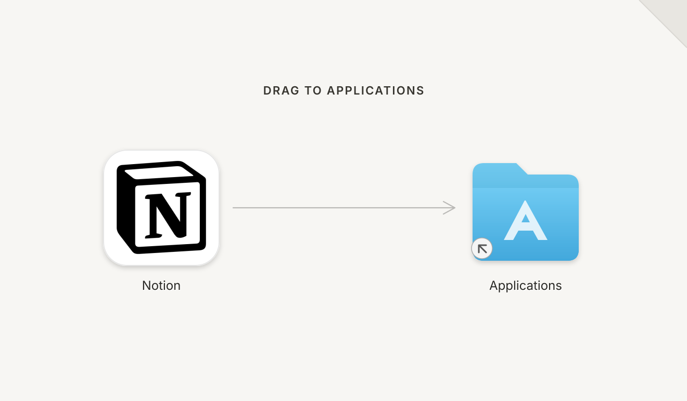
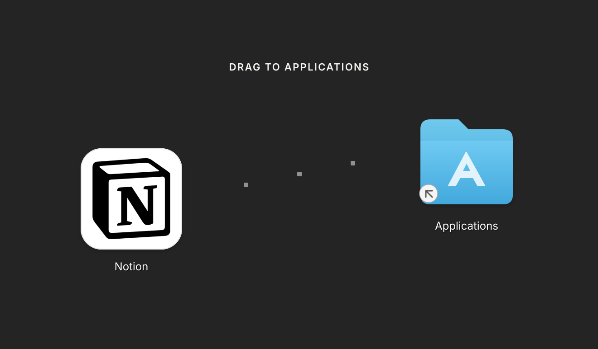
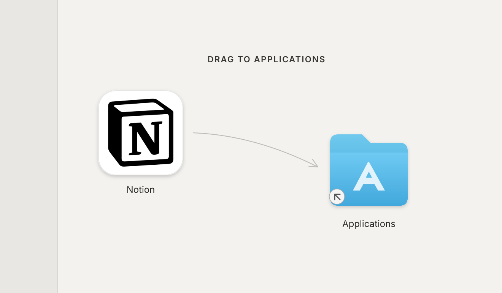

<h1 align="center">Drop Your DMG</h1>

<p align="center"><strong>An agent skill that designs the installer from the product, then builds it.</strong><br>Three real directions, one chosen DMG, no visual editor.</p>

<p align="center">
  
  
  
</p>

---

Most DMG builders start with an empty canvas. Drop Your DMG starts with the product.

It inspects the app, icon, screenshots, brand assets and release setup; creates three genuinely different installer directions; shows real previews; waits for a choice; refines one; then builds and verifies the disk image with [`create-dmg`](https://github.com/create-dmg/create-dmg).

## Quick start

Install in [Pi](https://pi.dev):

```sh
pi install npm:drop-your-dmg
```

Then ask:

```text
Design a DMG installer for this app. Show me three directions before you build it.
```

Or invoke the skill directly:

```text
/skill:drop-your-dmg
```

The final build requires macOS and `create-dmg`. The skill checks for it and asks before installing it with Homebrew.

## Example

Notion gets three curated directions from the same minimal brief:

<table>
  <tr>
    <td width="33%"></td>
    <td width="33%"></td>
    <td width="33%"></td>
  </tr>
  <tr>
    <td><b>Quiet Page</b><br><sub>Calm and symmetrical</sub></td>
    <td><b>Block Path</b><br><sub>Dark and modular</sub></td>
    <td><b>Sidebar Shift</b><br><sub>Light and asymmetric</sub></td>
  </tr>
</table>

Rebuild and open the contact sheet:

```sh
npm run examples
open examples/notion/notion.html
```

## What it produces

Before selection:

- a short evidence-based product read;
- three named design directions;
- editable Retina background SVGs;
- separate previews with representative Finder items;
- explicit window, icon and coordinate values.

After selection:

- one refined background SVG and PNG;
- one reproducible `create-dmg` command or release script;
- one final DMG;
- integrity, mounted-content and Finder-presentation results;
- separate signing and notarization status.

It never paints fake app or Applications icons into the shipping background. Finder places the real items.

## How it works

1. **Inspect.** Read the product and release inputs without changing them.
2. **Direct.** Create three concepts that differ in layout and idea, not just color.
3. **Choose.** Stop for the user's selection, unless they explicitly delegate it.
4. **Refine.** Iterate only on the chosen direction.
5. **Build.** Render with macOS `sips` and package with `create-dmg`.
6. **Verify.** Run `hdiutil verify`, mount read-only, inspect contents and review the actual Finder window.

The complete instructions are in [`SKILL.md`](SKILL.md). Focused guidance lives under [`references/`](references), and evaluation cases under [`evals/`](evals).

## Repository

```text
.
├── SKILL.md
├── agents/
│   └── openai.yaml
├── evals/
│   └── evals.json
├── examples/
│   └── notion/
├── references/
│   ├── build.md
│   ├── design.md
│   ├── product-review.md
│   ├── verify.md
│   └── walkthrough.md
├── scripts/
│   ├── check.mjs
│   └── render-examples.sh
└── tests/
    └── check.test.mjs
```

## Checks

```sh
npm run verify
npm pack --dry-run
```

On macOS, also render every example SVG and verify its Retina dimensions:

```sh
./scripts/render-examples.sh
```

Generated PNGs go to `shots/`, which is ignored.

## Limits

- DMG building and real Finder verification require macOS.
- A headless CI build cannot prove Finder presentation.
- The skill does not repair app signing, invent signing identities or claim notarization from a successful build.
- It does not replace the product's release pipeline; it adds the selected artwork and reproducible DMG step.

## Publish

The npm name `drop-your-dmg` is configured as a public package:

```sh
npm login
npm run verify
npm publish
```

## Contributing

Read [`CONTRIBUTING.md`](CONTRIBUTING.md). Visual changes must rebuild the examples and include reviewed previews. Instruction changes should add or update an eval.

## License

[MIT](LICENSE)
